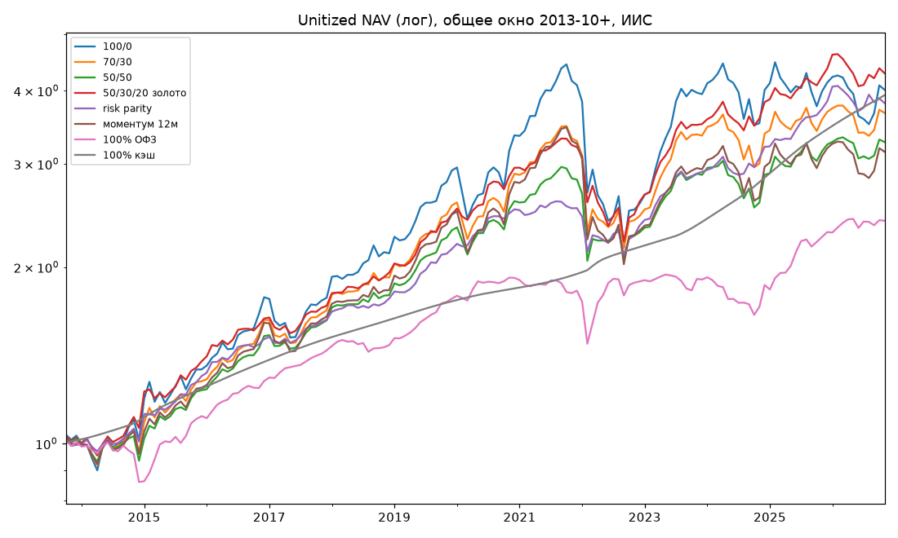
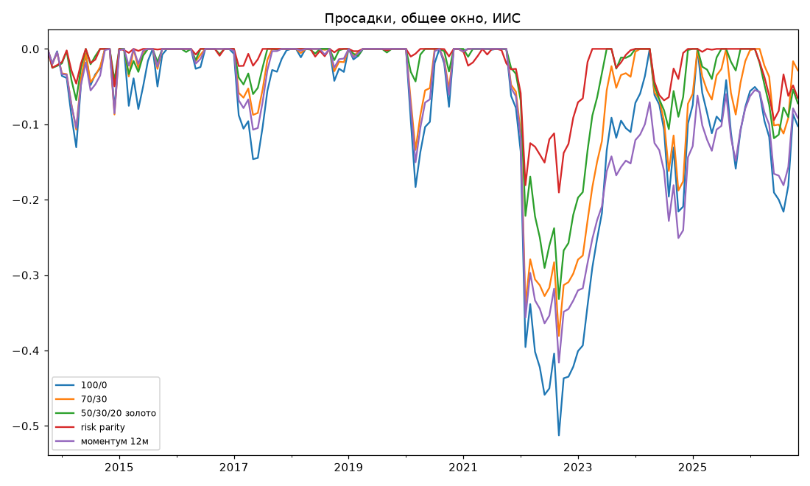
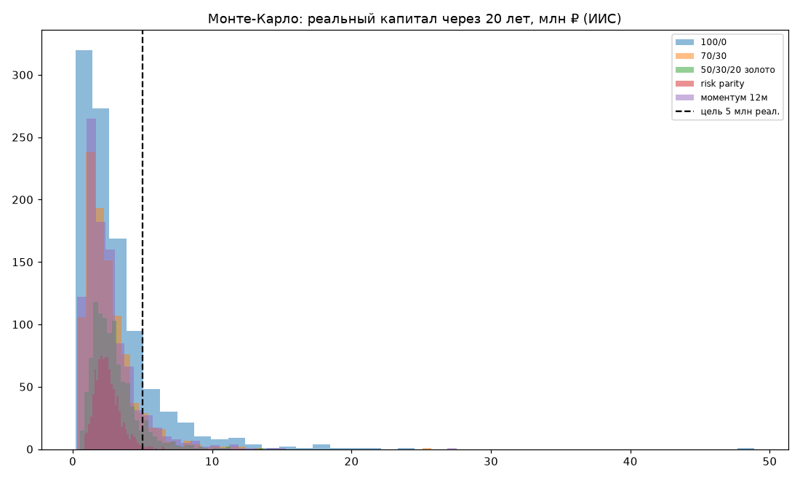

# Исследование: стратегия для рядового инвестора (РФ, ИИС-3 vs брокерский)

Данные: MOEX ISS (MCFTR, RGBITR, RUCBITR→RUCBTRNS, IMOEX), ЦБ (золото, USD/RUB,
ключевая ставка, CPI). Период: 2003-02 — 2026-11.
Модель: 10 000 ₽/мес, ребалансировка взносами + годовая при отклонении >5 п.п.,
комиссия 0,05%. Налоги: 13%; на брокерском — дивиденды/купоны ежегодно
(drag по реальной дивдоходности MCFTR/IMOEX и купону ≈ ключевая ставка),
на ИИС-3 — вычет реинвестируется, прибыль освобождена до 30 млн.
«Финал реал.» — финальный капитал после налогов в рублях начала окна.

## Контроль look-ahead
Честный моментум NAV=8.45 vs подглядывающий 11.59
(peek лучше — значит, движок различает будущее и прошлое, утечки нет).

## Исторический бэктест, максимальное окно
| Стратегия | Счёт | Старт | Внесено | Финал нетто, ₽ | Финал реал., ₽ | CAGR | МаксПрос | Ulcer | Sharpe |
|---|---|---|---|---|---|---|---|---|---|
| 100/0 | iis | 2003-02 | 3,217,500 | 13,757,964 | 2,077,630 | 13.6% | -67.9% | 18.4 | 0.65 |
| 100/0 | broker | 2003-02 | 2,860,000 | 9,875,664 | 1,491,353 | 12.9% | -67.9% | 18.9 | 0.63 |
| 80/20 | iis | 2003-02 | 3,217,500 | 13,474,086 | 2,034,761 | 13.3% | -56.2% | 13.9 | 0.73 |
| 80/20 | broker | 2003-02 | 2,860,000 | 9,466,350 | 1,429,541 | 12.5% | -56.3% | 14.3 | 0.69 |
| 70/30 | iis | 2003-02 | 3,217,500 | 13,810,999 | 2,085,639 | 13.3% | -50.6% | 11.7 | 0.78 |
| 70/30 | broker | 2003-02 | 2,860,000 | 9,572,257 | 1,445,534 | 12.4% | -50.8% | 12.0 | 0.74 |
| 60/40 | iis | 2003-02 | 3,217,500 | 13,448,217 | 2,030,854 | 12.9% | -45.0% | 10.1 | 0.83 |
| 60/40 | broker | 2003-02 | 2,860,000 | 9,213,956 | 1,391,426 | 11.9% | -45.2% | 10.3 | 0.78 |
| 50/50 | iis | 2003-02 | 3,217,500 | 12,801,149 | 1,933,139 | 12.4% | -39.4% | 8.6 | 0.89 |
| 50/50 | broker | 2003-02 | 2,860,000 | 8,735,450 | 1,319,166 | 11.4% | -39.6% | 8.8 | 0.82 |
| 40/60 | iis | 2003-02 | 3,217,500 | 12,194,075 | 1,841,463 | 11.9% | -33.5% | 7.1 | 0.96 |
| 40/60 | broker | 2003-02 | 2,860,000 | 8,258,269 | 1,247,105 | 10.8% | -33.8% | 7.4 | 0.87 |
| 70/30 корп | iis | 2003-02 | 3,217,500 | 14,465,620 | 2,184,495 | 13.2% | -52.1% | 12.0 | 0.80 |
| 70/30 корп | broker | 2003-02 | 2,860,000 | 9,989,736 | 1,508,579 | 12.3% | -52.3% | 12.3 | 0.75 |
| 60/30/10 золото | iis | 2008-02 | 2,539,500 | 7,553,443 | 1,932,129 | 9.7% | -48.4% | 11.3 | 0.67 |
| 60/30/10 золото | broker | 2008-02 | 2,260,000 | 5,401,152 | 1,381,585 | 8.6% | -48.4% | 11.8 | 0.61 |
| 50/30/20 золото | iis | 2008-02 | 2,539,500 | 8,059,046 | 2,061,459 | 10.5% | -41.7% | 9.3 | 0.80 |
| 50/30/20 золото | broker | 2008-02 | 2,260,000 | 5,905,193 | 1,510,515 | 9.7% | -41.7% | 9.4 | 0.75 |
| risk parity | iis | 2008-02 | 2,539,500 | 7,455,289 | 1,907,021 | 10.7% | -19.1% | 4.0 | 1.26 |
| risk parity | broker | 2008-02 | 2,260,000 | 5,423,943 | 1,387,414 | 9.7% | -20.0% | 4.2 | 1.14 |
| glide 90->40 | iis | 2003-02 | 3,217,500 | 13,785,661 | 2,081,813 | 13.6% | -56.0% | 11.8 | 0.78 |
| glide 90->40 | broker | 2003-02 | 2,860,000 | 9,501,078 | 1,434,785 | 12.6% | -56.1% | 12.1 | 0.74 |
| моментум 12м | iis | 2004-02 | 3,081,900 | 9,508,727 | 1,607,894 | 10.7% | -53.9% | 15.2 | 0.63 |
| моментум 12м | broker | 2004-02 | 2,740,000 | 6,783,744 | 1,147,108 | 9.8% | -53.7% | 16.0 | 0.59 |
| реальная ставка | iis | 2013-10 | 1,771,100 | 3,430,408 | 1,380,599 | 10.7% | -40.8% | 10.9 | 0.72 |
| реальная ставка | broker | 2013-10 | 1,580,000 | 2,634,395 | 1,060,236 | 9.5% | -41.5% | 11.3 | 0.65 |
| 100% ОФЗ | iis | 2003-02 | 3,217,500 | 8,910,665 | 1,345,625 | 8.8% | -22.8% | 3.5 | 1.07 |
| 100% ОФЗ | broker | 2003-02 | 2,860,000 | 5,948,608 | 898,317 | 7.4% | -23.6% | 4.2 | 0.91 |
| 100% корп | iis | 2003-02 | 3,217,500 | 10,482,235 | 1,582,953 | 8.7% | -16.6% | 2.4 | 1.76 |
| 100% корп | broker | 2003-02 | 2,860,000 | 6,946,143 | 1,048,957 | 7.3% | -16.7% | 2.5 | 1.50 |
| 100% кэш | iis | 2013-10 | 1,771,100 | 4,087,348 | 1,644,991 | 11.0% | 0.0% | 0.0 | 7.88 |
| 100% кэш | broker | 2013-10 | 1,580,000 | 3,036,171 | 1,221,935 | 9.5% | 0.0% | 0.0 | 7.88 |

## Общее окно 2013-10+ (сравнение «в лоб»)
| Стратегия | Счёт | Старт | Внесено | Финал нетто, ₽ | Финал реал., ₽ | CAGR | МаксПрос | Ulcer | Sharpe |
|---|---|---|---|---|---|---|---|---|---|
| 100/0 | iis | 2013-10 | 1,771,100 | 3,382,716 | 1,361,405 | 11.1% | -51.3% | 14.8 | 0.61 |
| 100/0 | broker | 2013-10 | 1,580,000 | 2,643,301 | 1,063,821 | 10.2% | -51.6% | 15.5 | 0.57 |
| 80/20 | iis | 2013-10 | 1,771,100 | 3,375,188 | 1,358,375 | 10.7% | -42.1% | 11.6 | 0.68 |
| 80/20 | broker | 2013-10 | 1,580,000 | 2,615,918 | 1,052,800 | 9.6% | -42.7% | 12.0 | 0.62 |
| 70/30 | iis | 2013-10 | 1,771,100 | 3,332,305 | 1,341,117 | 10.4% | -38.1% | 10.4 | 0.70 |
| 70/30 | broker | 2013-10 | 1,580,000 | 2,574,005 | 1,035,932 | 9.2% | -38.8% | 10.8 | 0.64 |
| 60/40 | iis | 2013-10 | 1,771,100 | 3,278,664 | 1,319,528 | 10.0% | -34.3% | 9.3 | 0.73 |
| 60/40 | broker | 2013-10 | 1,580,000 | 2,525,271 | 1,016,319 | 8.8% | -35.1% | 9.7 | 0.65 |
| 50/50 | iis | 2013-10 | 1,771,100 | 3,173,840 | 1,277,341 | 9.4% | -30.9% | 8.3 | 0.74 |
| 50/50 | broker | 2013-10 | 1,580,000 | 2,449,353 | 985,765 | 8.2% | -31.2% | 8.7 | 0.66 |
| 40/60 | iis | 2013-10 | 1,771,100 | 3,200,552 | 1,288,091 | 9.3% | -28.5% | 6.6 | 0.80 |
| 40/60 | broker | 2013-10 | 1,580,000 | 2,455,233 | 988,131 | 8.0% | -28.8% | 7.0 | 0.70 |
| 70/30 корп | iis | 2013-10 | 1,771,100 | 3,562,525 | 1,433,771 | 11.1% | -36.5% | 9.8 | 0.79 |
| 70/30 корп | broker | 2013-10 | 1,580,000 | 2,733,766 | 1,100,229 | 10.0% | -37.2% | 10.2 | 0.72 |
| 60/30/10 золото | iis | 2013-10 | 1,771,100 | 3,526,861 | 1,419,418 | 11.1% | -35.6% | 9.0 | 0.84 |
| 60/30/10 золото | broker | 2013-10 | 1,580,000 | 2,735,390 | 1,100,883 | 10.0% | -36.3% | 9.3 | 0.77 |
| 50/30/20 золото | iis | 2013-10 | 1,771,100 | 3,725,064 | 1,499,186 | 11.7% | -33.2% | 7.7 | 0.96 |
| 50/30/20 золото | broker | 2013-10 | 1,580,000 | 2,897,356 | 1,166,068 | 10.8% | -33.8% | 8.0 | 0.89 |
| risk parity | iis | 2013-10 | 1,771,100 | 3,624,882 | 1,458,867 | 10.7% | -19.0% | 4.3 | 1.17 |
| risk parity | broker | 2013-10 | 1,580,000 | 2,791,613 | 1,123,510 | 9.6% | -20.0% | 4.6 | 1.06 |
| glide 90->40 | iis | 2013-10 | 1,771,100 | 3,431,549 | 1,381,059 | 10.8% | -32.6% | 9.0 | 0.76 |
| glide 90->40 | broker | 2013-10 | 1,580,000 | 2,632,700 | 1,059,554 | 9.7% | -33.3% | 9.5 | 0.69 |
| моментум 12м | iis | 2013-10 | 1,771,100 | 2,988,892 | 1,202,907 | 9.1% | -41.6% | 13.1 | 0.61 |
| моментум 12м | broker | 2013-10 | 1,580,000 | 2,344,816 | 943,693 | 8.0% | -41.9% | 14.1 | 0.55 |
| реальная ставка | iis | 2013-10 | 1,771,100 | 3,430,408 | 1,380,599 | 10.7% | -40.8% | 10.9 | 0.72 |
| реальная ставка | broker | 2013-10 | 1,580,000 | 2,634,395 | 1,060,236 | 9.5% | -41.5% | 11.3 | 0.65 |
| 100% ОФЗ | iis | 2013-10 | 1,771,100 | 2,832,578 | 1,139,997 | 6.9% | -22.8% | 4.5 | 0.74 |
| 100% ОФЗ | broker | 2013-10 | 1,580,000 | 2,172,582 | 874,376 | 5.4% | -23.6% | 5.4 | 0.60 |
| 100% корп | iis | 2013-10 | 1,771,100 | 3,446,483 | 1,387,069 | 9.1% | -10.1% | 1.5 | 1.76 |
| 100% корп | broker | 2013-10 | 1,580,000 | 2,595,830 | 1,044,716 | 7.6% | -10.9% | 1.7 | 1.50 |
| 100% кэш | iis | 2013-10 | 1,771,100 | 4,087,348 | 1,644,991 | 11.0% | 0.0% | 0.0 | 7.88 |
| 100% кэш | broker | 2013-10 | 1,580,000 | 3,036,171 | 1,221,935 | 9.5% | 0.0% | 0.0 | 7.88 |

## Монте-Карло: block bootstrap (12 мес), 1000 путей × 20 лет, реальные ₽
Медианные drag'и брокерского счёта: дивиденды 0.0522%/мес, купоны 0.0951%/мес.
| Стратегия | Счёт | 5% реал. | Медиана реал. | 95% реал. | P(≥5 млн) | МаксПрос мед. | МаксПрос 5% |
|---|---|---|---|---|---|---|---|
| 100/0 | iis | 515,565 | 2,076,089 | 8,185,263 | 14.8% | -64.8% | -85.1% |
| 100/0 | broker | 432,490 | 1,564,391 | 5,895,792 | 8.3% | -65.0% | -85.6% |
| 70/30 | iis | 744,469 | 2,068,925 | 5,909,797 | 7.9% | -48.3% | -68.1% |
| 70/30 | broker | 600,357 | 1,531,145 | 4,217,268 | 2.8% | -48.9% | -69.5% |
| 50/30/20 золото | iis | 1,115,295 | 2,591,738 | 5,856,159 | 9.8% | -34.7% | -49.8% |
| 50/30/20 золото | broker | 867,570 | 1,925,879 | 4,248,367 | 2.9% | -35.3% | -50.8% |
| risk parity | iis | 1,292,897 | 2,364,332 | 4,187,567 | 1.4% | -19.5% | -33.7% |
| risk parity | broker | 978,478 | 1,730,036 | 3,011,428 | 0.0% | -20.2% | -35.0% |
| glide 90->40 | iis | 843,701 | 2,014,246 | 5,218,461 | 6.3% | -45.0% | -67.9% |
| glide 90->40 | broker | 665,915 | 1,483,100 | 3,700,652 | 1.7% | -46.0% | -69.4% |
| моментум 12м | iis | 700,521 | 2,042,056 | 6,237,984 | 9.1% | -48.0% | -66.8% |
| моментум 12м | broker | 567,574 | 1,504,733 | 4,443,164 | 3.6% | -48.5% | -67.9% |
| 100% ОФЗ | iis | 982,263 | 1,677,052 | 2,845,759 | 0.0% | -22.0% | -31.0% |
| 100% ОФЗ | broker | 737,372 | 1,207,048 | 1,974,336 | 0.0% | -22.5% | -33.5% |

## Стресс-окна (мин. просадка внутри окна, unitized NAV, ИИС)
| Стратегия | 2008–09 | 2014–15 | 2020 | 2022 |
|---|---|---|---|---|
| 100/0 | -67.9% | -8.0% | -18.3% | -43.6% |
| 70/30 | -50.6% | -8.7% | -13.8% | -29.6% |
| 50/50 | -39.4% | -9.1% | -10.1% | -22.5% |
| 50/30/20 золото | -41.7% | -3.7% | -5.0% | -27.4% |
| risk parity | -11.5% | -4.4% | -0.7% | -14.0% |
| моментум 12м | -53.9% | -8.5% | -15.1% | -35.6% |
| 100% ОФЗ | -7.9% | -14.4% | -1.8% | -15.2% |

## Walk-forward: моментум (подбор на 2004–2014, проверка на 2015+)
| Параметры | CAGR test 2015+ | МаксПрос | Sharpe |
|---|---|---|---|
| лучшие на train (6, 0.7, 0.5) | 11.8% | -36.6% | 0.78 |
| дефолт (12,0.8,0.5) | 10.2% | -41.4% | 0.64 |

## Графики




## Выводы

### 1. Asset location важнее asset allocation
ИИС-3 даёт **+30–40% к финальному капиталу** против брокерского счёта на одной и той
же стратегии (100/0 за 23,8 года: 13,76 млн vs 9,88 млн ₽). Драйвер — реинвестируемый
вычет 13% на взносы (внесено 3,22 млн против 2,86 млн) и нулевой налог на выходе.
Сценарий ЛДВ на брокерском счёте (прирост акций освобождён) сокращает разрыв, но не
закрывает его: 100/0 с ЛДВ — 10,92 млн против 13,76 млн на ИИС.
**Лимит 30 млн освобождаемой прибыли недостижим** при взносах 10 тыс./мес: максимум
за 23,8 года — 14,5 млн номинально. Ротации счетов ради лимита целевому пользователю
не нужны. Вывод для продукта: пока взносы ≤ 400 тыс./год и горизонт ≥ мин. срока ИИС —
всё на ИИС; гибрид имеет смысл только при взносах сверх базы вычета или целях < 5 лет.

### 2. Плавающие доли не оправдались — ядро должно быть фиксированным
- **Моментум 12м** хуже статики на обоих окнах: на общем окне CAGR 9,1% против 10,4%
  у 70/30 при худшей просадке (-41,6% vs -38,1%). Walk-forward показал 11,8% на test
  для параметров (6, 0.7, 0.5), но это единичный сдвиг без робастности.
- **Тактика по реальной ставке** (±10 п.п. от ядра) совпала по CAGR со статикой
  (10,7%) при той же просадке — преимущества нет.
Сигналы «политика/экономика» в алгоритм не закладываем.
**Обновление 2026-11-20:** режимная модель с доказанными сигналами (откуп кризиса,
FX-шок) преимущество всё же показала — см. разделы «Факторный анализ» и
«Режимные стратегии» ниже.

### 3. Рекомендуемая структура ядра
- **70/30 не «не то»**: на полном окне 70/30 обогнал 100/0 по реальному финалу
  (2,086 млн vs 2,078 млн) при просадке -50,6% против -67,9%. Классика работает.
- **Лучший баланс риск/результат — с золотом**: 50/30/20 (акции/ОФЗ/золото) на общем
  окне CAGR 11,7% (лучше 100/0!) при просадке -33%; в Монте-Карло — лучшая медиана
  реального капитала (2,59 млн) и лучший 5%-й перцентиль среди рисковых стратегий.
- **Risk parity** — для консервативного профиля: просадка -19% (против -51% у 100/0),
  Sharpe 1,17–1,26, но потолок доходности ниже (95% перцентиль 4,19 млн против 8,19 млн).
- **Корпоративные облигации исторически лучше ОФЗ**: Sharpe 1,76, просадка -10…-17%.
  Осторожно: индексный ряд сшит (RUCBITR→RUCBTRNS), кредитные события в индексе
  сглажены — разумный перевес корпоративных, а не 100%.
- ОФЗ **не защита при шоке ставки**: -14,4% в 2014–15 и -15,2% в 2022.

### 4. Честность о целях
При 10 тыс./мес и горизонте 20 лет цель «5 млн в сегодняшних деньгах» достигается
лишь в 1,4–14,8% сценариев (лучшая — 100% акции, ценой просадок до -85% в 5% путей).
Продукт должен показывать вероятность достижения цели и предлагать рычаги:
взнос, горизонт, цель — а не обещать доходность.

### Ограничения исследования
CPI до 2013 — годовые значения Росстата, продублированные по месяцам; купонный drag
приближён ключевой ставкой; кэш-прокси не имеет волатильности (Sharpe 7,88 — артефакт,
не вывод); корп. индекс сшит из двух рядов (корреляция доходностей в пересечении 0,98);
золото — учётные цены ЦБ без спреда покупки; налог моделирован плоскими 13%;
индексы полной доходности предполагают безналоговое реинвестирование внутри индекса.


---

## Факторный анализ (2026-11-20, данные 1997–2026)

Расширенные ряды: акции с 1997-09 (IMOEX + оценка дивидендов 1,5%/год до 2003),
денежная ставка с 1992 (сшивка ставки рефинансирования ЦБ и ключевой; уровни
инструментов разные — на границе 2013-09 скачок 8,25→5,5 п.п., учтён в выводах),
USD/RUB с 1997. Полные таблицы: `data/factor_tables.md`.

Ключевые наблюдения (следующие 12 мес после состояния, `*` — 95% ДИ значимо):
- **Кризис EQ (<−30% от 12м макс): +100,4%** [+20,7..+155,6]* — сильнейший сигнал
  «откупать просадку» (38 мес, включая 1998, 2008, 2020, 2022).
- **FX-шок (>15%/3мес): +102,0%** [+0,6..+150,1]* — после девальваций рублёвые
  акции раллируют (29 мес).
- Реальная ставка >4 п.п.: EQ +34,6% vs +23,9% при <1 п.п. — направление против
  интуиции «ставка душит акции», не значимо; OFZ +10,9% vs +6,0% — логично,
  не значимо; золото при <1 п.п. +29,0% vs +8,7% — направление сильное.
- ERP (дивдоходность > ставка): OFZ **−0,7%** [−14,8..−2,4]* — в такие периоды
  облигации теряют (режим догоняющего повышения ставок).
- Направление/смена ставки и сам по себе ERP для акций — без значимого сигнала.

## Режимные стратегии (правила зафиксированы до бэктеста)

Карта режимов (EQ/OFZ/GOLD): normal 50/30/20; crisis 65/20/15; fx 60/25/15;
hi_rate 45/40/15; lo_rate 55/20/25; ERP>0 → −10 п.п. ОФЗ в акции; рамки акций
[30,75]%; выход из режима после 2 чистых месяцев. Вариант А — переход только
взносами, Б — + оборот до 5%/мес.

Peek-контроль: честная NAV=6.87 vs peek 6.76 — утечки нет.

### Режимы по годам (контроль адекватности сигнала)
```
      crisis  fx  hi_rate  lo_rate  normal
t                                         
2008       3   0        0        8       0
2009       8   0        0        2       2
2010       0   0        0       12       0
2011       0   0        0        2      10
2012       0   0        0        0      12
2013       0   0        0        3       9
2014       0   3        0        9       0
2015       0   5        0        7       0
2016       0   2        1        1       8
2017       0   0       12        0       0
2018       0   0       10        0       2
2019       0   0        0        0      12
2020       3   0        0        0       9
2021       0   0        0       11       1
2022      10   0        0        2       0
2023       5   0        2        1       4
2024       0   1       11        0       0
2025       0   0       12        0       0
2026       0   1       10        0       0
```

### История: режимы vs статика
| Стратегия | Счёт | Старт | Внесено | Финал нетто, ₽ | Финал реал., ₽ | CAGR | МаксПрос | Ulcer | Sharpe |
|---|---|---|---|---|---|---|---|---|---|
| 50/30/20 (статика) | iis | 2008-02 | 2,539,500 | 8,059,046 | 2,061,459 | 10.5% | -41.7% | 9.3 | 0.80 |
| 50/30/20 (статика) | broker | 2008-02 | 2,260,000 | 5,911,619 | 1,512,159 | 9.7% | -41.8% | 9.4 | 0.75 |
| risk parity | iis | 2008-02 | 2,539,500 | 7,455,289 | 1,907,021 | 10.7% | -19.1% | 4.0 | 1.26 |
| risk parity | broker | 2008-02 | 2,260,000 | 5,436,420 | 1,390,606 | 9.7% | -20.0% | 4.2 | 1.15 |
| 70/30 (статика) | iis | 2008-02 | 2,539,500 | 6,901,159 | 1,765,278 | 8.6% | -54.5% | 14.0 | 0.55 |
| 70/30 (статика) | broker | 2008-02 | 2,260,000 | 5,009,985 | 1,281,526 | 7.7% | -54.6% | 14.3 | 0.50 |
| режим А (взносами) | iis | 2008-02 | 2,539,500 | 9,087,826 | 2,324,615 | 11.6% | -44.2% | 9.9 | 0.82 |
| режим А (взносами) | broker | 2008-02 | 2,260,000 | 6,577,057 | 1,682,374 | 10.8% | -44.2% | 10.0 | 0.77 |
| режим Б (+5%/мес) | iis | 2008-02 | 2,539,500 | 9,148,162 | 2,340,049 | 11.3% | -46.3% | 9.9 | 0.79 |
| режим Б (+5%/мес) | broker | 2008-02 | 2,260,000 | 6,652,451 | 1,701,660 | 10.5% | -46.3% | 10.1 | 0.74 |
| режим А н/з (2003+) | iis | 2003-02 | 3,217,500 | 14,648,011 | 2,212,039 | 13.5% | -49.5% | 11.2 | 0.81 |
| режим А н/з (2003+) | broker | 2003-02 | 2,860,000 | 9,986,900 | 1,508,151 | 12.5% | -50.3% | 11.6 | 0.75 |
| режим Б н/з (2003+) | iis | 2003-02 | 3,217,500 | 13,924,563 | 2,102,789 | 13.1% | -54.2% | 12.1 | 0.77 |
| режим Б н/з (2003+) | broker | 2003-02 | 2,860,000 | 9,837,447 | 1,485,581 | 12.3% | -52.6% | 11.9 | 0.74 |

### Walk-forward (train 2008–2014 → test 2015+)
| Параметры | CAGR test 2015+ | МаксПрос | Sharpe |
|---|---|---|---|
| лучшие на train (-0.3, 3.0) | 13.5% | -34.3% | 1.00 |
| дефолт (-30%, 4) | 13.8% | -34.4% | 1.01 |

### Монте-Карло (те же 1000 bootstrap-путей; реальная ставка — прокси 12м ОФЗ − CPI)
| Стратегия | Счёт | 5% реал. | Медиана реал. | 95% реал. | P(≥5 млн) | МаксПрос мед. | МаксПрос 5% |
|---|---|---|---|---|---|---|---|
| 50/30/20 (статика) | iis | 1,115,295 | 2,591,738 | 5,856,159 | 9.8% | -34.7% | -49.8% |
| 50/30/20 (статика) | broker | 862,699 | 1,915,421 | 4,223,753 | 2.7% | -35.4% | -50.8% |
| risk parity | iis | 1,292,897 | 2,364,332 | 4,187,567 | 1.4% | -19.5% | -33.7% |
| risk parity | broker | 968,106 | 1,711,082 | 2,976,014 | 0.0% | -20.2% | -35.1% |
| режим А (взносами) | iis | 997,892 | 2,575,554 | 5,873,099 | 9.4% | -35.2% | -55.3% |
| режим А (взносами) | broker | 777,462 | 1,901,405 | 4,214,345 | 3.3% | -35.8% | -56.2% |
| режим Б (+5%/мес) | iis | 1,091,120 | 2,754,015 | 6,281,461 | 10.9% | -37.3% | -56.8% |
| режим Б (+5%/мес) | broker | 842,722 | 2,010,806 | 4,511,450 | 3.6% | -37.7% | -57.2% |

### Выводы по режимам

**Режимное переключение — первая тактика, показавшая устойчивое преимущество над статикой** (в отличие от моментума и плавания ±10 п.п. по реальной ставке):

1. **История 2008+ (ИИС): режим А (только взносами) — CAGR 11,6% против 10,5% у
   50/30/20, финал 9,09 млн против 8,06 млн (+13%)** при сопоставимой просадке
   (−44% vs −42%). На длинном окне 2003+ без золота: 13,5% против 13,3% у 70/30
   при меньшей просадке (−49,5% vs −50,6%). Преимущество скромное, но на всех
   окнах в одну сторону.
2. **Робастность:** walk-forward показал плоскую поверхность параметров
   (train CAGR 6,9–7,3% на всей сетке порогов) — хрупкого оптимума нет;
   на test 2015+ дефолтные пороги дали **13,8% CAGR, Sharpe 1,01** — лучше любой
   статики на том же окне.
3. **Монте-Карло:** режим Б — лучшая медиана реального капитала (2,75 млн против
   2,59 млн у статики) и лучший 95-й перцентиль (6,28 млн). Но левый хвост не
   улучшается (5-й перцентиль 1,09 млн против 1,12 млн; медианная просадка чуть
   хуже): режимы добавляют **правый хвост** (откуп кризисов), а не защиту.
4. **Механизм перехода:** А (только взносами) ≈ Б (+5% оборота/мес) по итогу —
   ускоренный оборот не окупается. Рекомендуется вариант А: проще, нет налоговых
   последствий даже на брокерском счёте, дисциплина «новые деньги — в
   недовешенное».
5. **Что именно работает:** значимы только два сигнала — откуп кризиса
   (DD < −30% → +100% следующие 12 мес) и пост-девальвационное ралли.
   Сигналы по реальной ставке и ERP — направления без статзначимости; их вес в
   карте режимов стоит держать минимальным.
6. **Ограничения:** в МК реальная ставка заменена прокси (12м ОФЗ − CPI) —
   режимные МК-результаты приближённые; историческое преимущество заработано на
   немногих эпизодах (38 кризисных месяцев за 29 лет), т.е. стратегия требует
   дисциплины именно в моменты максимального страха.

**Итоговая рекомендация для продукта:** ядро — статика 50/30/20 (или risk parity
для консерваторов) + одно доказанное правило «при просадке индекса > 30% от
годового максимума взносы направлять в акции до доли 65–75%». Остальные режимы —
опциональные тилты с малым весом, не обещающие эффекта.

## Приложение: полные факторные таблицы
# Факторный анализ: условные доходности (1997–2026)

Состояние мира на конец месяца t → средние ПОСЛЕДУЮЩИЕ доходности.
95% ДИ — block bootstrap разницы средних «состояние vs вся выборка» для 12-мес горизонта; `*` — статзначимое отличие.


## EQ (с 1997-10)


### Реальная ставка

| Состояние | n мес | след.3м | след.6м | след.12м | 95% ДИ Δ средн. (12м) |
|---|---|---|---|---|---|
| высокая (>4) | 125 | +8.5% | +15.4% | +34.6% | -9.5%..+37.1% |
| низкая (<1) | 101 | +2.5% | +10.3% | +23.9% | -31.8%..+35.6% |
| норма | 124 | +6.3% | +12.5% | +25.0% | -17.0%..+14.1% |
| вся выборка | 350 | +6.0% | +12.9% | +27.9% |  |

### Просадка EQ

| Состояние | n мес | след.3м | след.6м | след.12м | 95% ДИ Δ средн. (12м) |
|---|---|---|---|---|---|
| норма (0..-15%) | 277 | +4.2% | +8.4% | +17.6% | -19.5%..+2.2% |
| кризис (<-30%) | 38 | +19.9% | +51.3% | +100.4% | +20.7%..+155.6%* |
| стресс (-15..-30%) | 35 | +4.7% | +5.8% | +27.8% | -19.7%..+31.3% |
| вся выборка | 350 | +6.0% | +12.9% | +27.9% |  |

### FX-шок

| Состояние | n мес | след.3м | след.6м | след.12м | 95% ДИ Δ средн. (12м) |
|---|---|---|---|---|---|
| нет | 321 | +3.5% | +8.8% | +21.2% | -16.3%..+5.6% |
| девальвация >15%/3мес | 29 | +33.0% | +59.1% | +102.0% | +0.6%..+150.1%* |
| вся выборка | 350 | +6.0% | +12.9% | +27.9% |  |

### Ставка 6 мес

| Состояние | n мес | след.3м | след.6м | след.12м | 95% ДИ Δ средн. (12м) |
|---|---|---|---|---|---|
| снижение | 154 | +6.5% | +14.8% | +30.5% | -4.4%..+15.0% |
| повышение | 71 | +0.4% | +7.2% | +29.9% | -30.8%..+50.8% |
| пауза | 125 | +8.5% | +13.8% | +23.8% | -23.3%..+20.0% |
| вся выборка | 350 | +6.0% | +12.9% | +27.9% |  |

### ERP (дивы − ставка)

| Состояние | n мес | след.3м | след.6м | след.12м | 95% ДИ Δ средн. (12м) |
|---|---|---|---|---|---|
| акции дороги (<0) | 313 | +5.6% | +12.5% | +28.7% | -13.5%..+20.7% |
| акции дёшевы (>0) | 37 | +8.6% | +16.0% | +21.1% | -33.7%..+10.1% |
| вся выборка | 350 | +6.0% | +12.9% | +27.9% |  |

## OFZ (с 2003-02)


### Реальная ставка

| Состояние | n мес | след.3м | след.6м | след.12м | 95% ДИ Δ средн. (12м) |
|---|---|---|---|---|---|
| высокая (>4) | 72 | +2.4% | +4.5% | +10.9% | -6.3%..+11.8% |
| норма | 124 | +2.9% | +5.6% | +9.8% | -2.0%..+4.0% |
| низкая (<1) | 90 | +0.9% | +2.3% | +6.0% | -7.7%..+2.4% |
| вся выборка | 286 | +2.1% | +4.3% | +8.8% |  |

### Просадка EQ

| Состояние | n мес | след.3м | след.6м | след.12м | 95% ДИ Δ средн. (12м) |
|---|---|---|---|---|---|
| норма (0..-15%) | 244 | +1.8% | +3.5% | +7.6% | -4.6%..+1.5% |
| стресс (-15..-30%) | 21 | +3.0% | +7.1% | +14.2% | -1.0%..+13.4% |
| кризис (<-30%) | 21 | +5.4% | +10.2% | +18.1% | -4.8%..+22.8% |
| вся выборка | 286 | +2.1% | +4.3% | +8.8% |  |

### FX-шок

| Состояние | n мес | след.3м | след.6м | след.12м | 95% ДИ Δ средн. (12м) |
|---|---|---|---|---|---|
| нет | 265 | +1.9% | +3.9% | +8.1% | -3.9%..+2.0% |
| девальвация >15%/3мес | 21 | +4.7% | +8.7% | +17.3% | -3.4%..+18.5% |
| вся выборка | 286 | +2.1% | +4.3% | +8.8% |  |

### Ставка 6 мес

| Состояние | n мес | след.3м | след.6м | след.12м | 95% ДИ Δ средн. (12м) |
|---|---|---|---|---|---|
| снижение | 118 | +2.4% | +4.5% | +7.5% | -5.0%..+1.6% |
| пауза | 108 | +2.1% | +4.2% | +7.9% | -5.0%..+2.7% |
| повышение | 60 | +1.7% | +3.9% | +12.8% | -3.8%..+12.2% |
| вся выборка | 286 | +2.1% | +4.3% | +8.8% |  |

### ERP (дивы − ставка)

| Состояние | n мес | след.3м | след.6м | след.12м | 95% ДИ Δ средн. (12м) |
|---|---|---|---|---|---|
| акции дороги (<0) | 249 | +2.3% | +4.7% | +10.3% | -1.7%..+4.7% |
| акции дёшевы (>0) | 37 | +1.0% | +1.2% | -0.7% | -14.8%..-2.4%* |
| вся выборка | 286 | +2.1% | +4.3% | +8.8% |  |

## GOLD (с 2008-02)


### Реальная ставка

| Состояние | n мес | след.3м | след.6м | след.12м | 95% ДИ Δ средн. (12м) |
|---|---|---|---|---|---|
| низкая (<1) | 77 | +8.2% | +15.5% | +29.0% | -7.3%..+23.3% |
| высокая (>4) | 68 | +3.8% | +8.5% | +20.0% | -11.7%..+11.4% |
| норма | 81 | +1.7% | +3.7% | +8.7% | -22.0%..+3.4% |
| вся выборка | 226 | +4.6% | +9.2% | +19.0% |  |

### Просадка EQ

| Состояние | n мес | след.3м | след.6м | след.12м | 95% ДИ Δ средн. (12м) |
|---|---|---|---|---|---|
| норма (0..-15%) | 188 | +4.5% | +8.5% | +17.6% | -11.5%..+6.6% |
| стресс (-15..-30%) | 17 | +2.4% | +10.2% | +9.5% | -23.5%..+4.9% |
| кризис (<-30%) | 21 | +6.4% | +15.1% | +37.1% | -3.3%..+46.3% |
| вся выборка | 226 | +4.6% | +9.2% | +19.0% |  |

### FX-шок

| Состояние | n мес | след.3м | след.6м | след.12м | 95% ДИ Δ средн. (12м) |
|---|---|---|---|---|---|
| нет | 205 | +4.5% | +9.2% | +19.1% | -10.0%..+8.8% |
| девальвация >15%/3мес | 21 | +5.2% | +9.4% | +18.1% | -12.6%..+9.8% |
| вся выборка | 226 | +4.6% | +9.2% | +19.0% |  |

### Ставка 6 мес

| Состояние | n мес | след.3м | след.6м | след.12м | 95% ДИ Δ средн. (12м) |
|---|---|---|---|---|---|
| пауза | 81 | +2.8% | +4.2% | +12.2% | -19.2%..+4.8% |
| повышение | 60 | +4.3% | +12.2% | +24.4% | -12.0%..+16.8% |
| снижение | 85 | +6.4% | +11.9% | +21.9% | -7.4%..+17.0% |
| вся выборка | 226 | +4.6% | +9.2% | +19.0% |  |

### ERP (дивы − ставка)

| Состояние | n мес | след.3м | след.6м | след.12м | 95% ДИ Δ средн. (12м) |
|---|---|---|---|---|---|
| акции дороги (<0) | 189 | +4.0% | +8.3% | +18.4% | -10.4%..+7.6% |
| акции дёшевы (>0) | 37 | +7.3% | +13.9% | +21.5% | -19.6%..+26.3% |
| вся выборка | 226 | +4.6% | +9.2% | +19.0% |  |


---

## Форма взносов при 400 тыс./год (окно 2008+, ИИС)

Санити: при нулевой волатильности лимп-январь ≥ равномерного (2,953,086 vs 2,838,821) — даты взносов корректны.

| Стратегия | Счёт | Старт | Внесено | Финал нетто, ₽ | Финал реал., ₽ | CAGR | МаксПрос | Ulcer | Sharpe |
|---|---|---|---|---|---|---|---|---|---|
| 50/30/20 равномерно | iis | 2008-02 | 8,465,000 | 26,863,488 | 6,871,530 | 10.5% | -41.7% | 9.3 | 0.80 |
| 50/30/20 лимп-январь | iis | 2008-02 | 8,084,000 | 25,236,956 | 6,455,473 | 13.0% | -34.1% | 6.9 | 1.07 |
| 50/30/20 терпеливый лимп | iis | 2008-02 | 8,084,000 | 26,539,790 | 6,788,730 | 13.1% | -31.2% | 6.0 | 1.12 |
| режим А равномерно | iis | 2008-02 | 8,465,000 | 30,292,753 | 7,748,717 | 11.6% | -44.2% | 9.9 | 0.82 |
| режим А лимп-январь | iis | 2008-02 | 8,084,000 | 28,657,155 | 7,330,340 | 14.3% | -36.2% | 7.1 | 1.09 |
| режим А терпеливый | iis | 2008-02 | 8,084,000 | 26,539,790 | 6,788,730 | 13.1% | -31.2% | 6.0 | 1.12 |

### Маршрутизация сверх базы вычета (600 тыс./год, 2008+)
| Маршрут 600к/год | Финал нетто, ₽ | Налог, ₽ |
|---|---|---|
| гибрид 400к ИИС + 200к брокер | 36,716,187 | 909,407 |
| всё 600к на брокерский | 29,558,097 | 2,728,221 |
| всё 600к на ИИС (вычет всё равно с 400к) | 38,825,525 | 0 |

## «Порох на дне»: резерв под кризис (честный триггер DD < −30%)

Контроль: «вечное ожидание» в безкризисные 2016–2019 проигрывает DCA
(1.58 vs 1.78) — модель штрафует
за сидение в кэше. Peek-контроль: честная 5.77 vs
peek 4.89 (решения различаются, утечек нет).

| Стратегия | Счёт | Старт | Внесено | Финал нетто, ₽ | Финал реал., ₽ | CAGR | МаксПрос | Ulcer | Sharpe |
|---|---|---|---|---|---|---|---|---|---|
| 50/30/20 (бенчмарк) | iis | 2008-02 | 2,539,500 | 8,059,046 | 2,061,459 | 10.5% | -41.7% | 9.3 | 0.80 |
| 50/30/20 (бенчмарк) | broker | 2008-02 | 2,260,000 | 5,911,619 | 1,512,159 | 9.7% | -41.8% | 9.4 | 0.75 |
| режим А (бенчмарк) | iis | 2008-02 | 2,539,500 | 9,087,826 | 2,324,615 | 11.6% | -44.2% | 9.9 | 0.82 |
| режим А (бенчмарк) | broker | 2008-02 | 2,260,000 | 6,577,057 | 1,682,374 | 10.8% | -44.2% | 10.0 | 0.77 |
| резерв-10 (45/40/15→75/10/15) | iis | 2008-02 | 2,539,500 | 7,308,707 | 1,869,526 | 9.7% | -47.5% | 10.2 | 0.70 |
| резерв-10 (45/40/15→75/10/15) | broker | 2008-02 | 2,260,000 | 5,379,881 | 1,376,144 | 8.9% | -47.6% | 10.4 | 0.64 |
| экстремальный тайминг | iis | 2008-02 | 2,539,500 | 5,380,057 | 1,376,189 | 8.9% | -34.2% | 7.9 | 0.67 |
| экстремальный тайминг | broker | 2008-02 | 2,260,000 | 3,844,783 | 983,474 | 7.5% | -35.2% | 8.7 | 0.58 |
| вечное ожидание | iis | 2008-02 | 2,539,500 | 7,601,297 | 1,944,369 | 11.6% | -51.3% | 14.6 | 0.63 |
| вечное ожидание | broker | 2008-02 | 2,260,000 | 5,605,908 | 1,433,960 | 10.8% | -51.6% | 15.2 | 0.59 |
| экстремум н/з (2003+) | iis | 2003-02 | 3,217,500 | 9,863,858 | 1,489,570 | 9.8% | -34.1% | 6.7 | 0.79 |
| экстремум н/з (2003+) | broker | 2003-02 | 2,860,000 | 6,567,927 | 991,842 | 8.5% | -35.1% | 7.5 | 0.69 |
| вечное ожидание н/з (2003+) | iis | 2003-02 | 3,217,500 | 14,733,038 | 2,224,879 | 12.0% | -51.3% | 12.9 | 0.68 |
| вечное ожидание н/з (2003+) | broker | 2003-02 | 2,860,000 | 10,345,914 | 1,562,367 | 11.1% | -51.6% | 13.4 | 0.64 |

### Walk-forward порога развёртывания
| Порог | CAGR test 2015+ | МаксПрос | Sharpe |
|---|---|---|---|
| лучший на train -0.3 | 11.8% | -37.1% | 0.89 |
| дефолт -30% | 11.8% | -37.1% | 0.89 |

### Монте-Карло
| Стратегия (ИИС) | 5% реал. | Медиана реал. | 95% реал. | P(≥5 млн) | МаксПрос мед. |
|---|---|---|---|---|---|
| 50/30/20 равномерно 10к | 1,115,295 | 2,591,738 | 5,856,159 | 9.8% | -34.7% |
| 50/30/20 равномерно 400к/год | 3,717,650 | 8,639,127 | 18,280,800 | 85.8% | -34.7% |
| 50/30/20 лимп-январь 400к | 3,722,238 | 9,004,820 | 19,612,191 | 87.4% | -34.4% |
| терпеливый лимп 400к | 3,683,473 | 8,860,372 | 19,239,191 | 87.3% | -35.0% |
| резерв-10 10к | 891,470 | 2,287,469 | 5,221,943 | 6.2% | -44.1% |
| экстремальный тайминг 10к | 694,680 | 1,621,175 | 3,356,244 | 0.8% | -31.3% |
| вечное ожидание 10к | 523,976 | 1,914,773 | 6,575,134 | 9.6% | -51.6% |

## Новостной скрининг критических состояний: дизайн (без бэктеста)

Количественная проверка невозможна честно: размеченного архива новостей
с 1997 года нет, а подгонять правила по подвыборке заголовков — значит
выдумать результат. Поэтому рекомендация архитектурная:

1. **LLM — слой объяснения, не слой сигнала.** Аллокацию меняют только
   механические правила с доказанной статистикой (DD < −30%, FX-шок).
   Это продолжение принципа проекта «агент не считает»: агент не решает.
2. **Что строить:** сбор (RSS RBC/Интерфакс/Коммерсантъ, ведомости, ЦБ) →
   дедупликация → LLM-дайджест два раза в день со структурированным блоком:
   `системный_риск: низкий/средний/высокий`, `затронутые сектора`,
   `суть в 3 предложениях`, `что было при похожих событиях (из нашего
   факторного анализа)`. Пользователь видит флаг рядом с механическим режимом.
3. **Валидация без бэктеста:** журнал флагов (jsonl с датой и уровнем) +
   автоматическая ретроспективная сверка через 3/6/12 мес — тот же формат
   условных доходностей, что и в факторном анализе. Через 1–2 года журнала
   появятся честные данные для решения, достоин ли флаг веса в аллокации.
4. **Что уже есть:** `src/news.py` (дельты целей аналитиков, инсайдеры, RSI,
   RSS Google News с тональностью по словарю). Для хакатона этого достаточно
   как демо-витрина; словарную тональность заменить на LLM-разметку —
   косметическое изменение `_tone_of`.

### Выводы по взносам и «пороху»

1. **Форма взносов 400к/год (МК, равные суммы): лимп в январе > равномерно >
   терпеливый лимп.** Медианы реального капитала за 20 лет: 9,00 млн / 8,64 млн /
   8,86 млн. Январский взнос выигрывает ~4% к медиане — деньги дольше работают.
   «Терпеливое» ожидание дна для годового взноса стоит ~1,5% медианы против
   простого январского: цена ожидания в ОФЗ съедает выгоду редких удачных
   развёртываний. Практический вывод: вносить на ИИС в начале года, как только
   деньги есть; искусственно ждать просадку не надо. Для тех, кто не может
   внести сразу 400к, равномерный график теряет немного — DCA остаётся нормой.
2. **Сверх базы вычета:** при 600 тыс./год гибрид «400к ИИС + 200к брокер»
   (36,7 млн) проигрывает «всё на ИИС» (38,8 млн) — освобождение прибыли ИИС-3
   ценнее вычета, поэтому и сверхбаза идёт на ИИС, пока прибыль далека от капа
   30 млн. Брокерский счёт нужен только под цели < мин. срока ИИС и подушку.
3. **«Порох на дне» — гипотеза не подтвердилась.** Все варианты с резервом
   проигрывают простой стратегии: резерв-10 — МК медиана 2,29 млн против 2,59 млн
   у 50/30/20 (и хуже левый хвост, и глубже просадки), экстремальный тайминг —
   1,62 млн, «вечное ожидание» — 1,91 млн при 5-м перцентиле 0,52 млн. Исторический
   успех «вечного ожидания» с 2003 (14,7 млн) — удача одной траектории
   (ОФЗ 2003–2008 + вход на дне 2008), в распределении она в левой половине.
   Правильный способ монетизировать откуп — не резерв, а **режимная
   перенастройка взносов** (режим А из прошлого исследования: +13% к финалу
   без цены ожидания) и, при наличии свободных денег вне графика, их внесение
   в кризисные месяцы — но это источник денег, а не стратегия.
4. **Новостной скрининг** — только как дайджест/объяснение (раздел выше):
   сигналы аллокации остаются механическими и проверяемыми.
